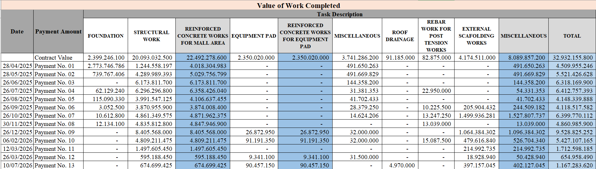
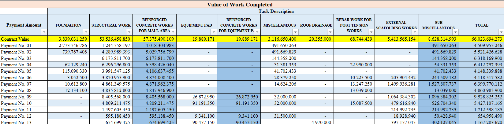
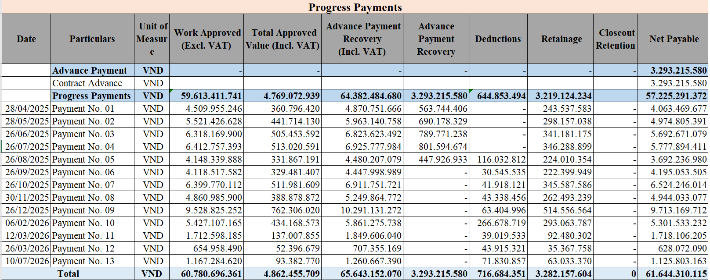
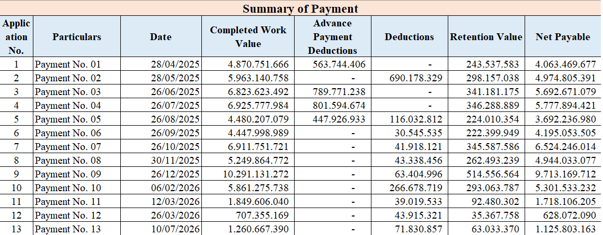

# Construction Payment Analytics & Cash Flow Assessment

## 📌 Project Overview
This repository contains a comprehensive financial analysis of a 13-milestone payment application for a commercial construction project (Mall Area). The objective was to transform fragmented, unstructured legacy ledgers into a standardized English dataset, analyze cash flow trends, and evaluate structural gaps between approved work and actual cash realization.

## 🚀 Executive Summary
Over the 13 certified milestones (Apr 2025 - Jul 2026), the Project converted **65.64 bn VND** of approved value (incl. VAT) into **61.64 bn VND** of cash (93.9%). Net Payable from progress payments alone was **58.35 bn VND**.

Our analysis highlights three critical insights for investors:
1. **Front-loaded Cash Inflow:** 94.0% of Net Payable was received by Milestone 10. The close-out phase (M11-M13) suffered a severe liquidity trough, with a 106-day gap without payment between M12 and M13.
2. **Scope Expansion (Variation Orders):** The original Mall Area contract (22.49 bn VND) was expanded to 57.38 bn VND. Cumulative certified work reached 55.26 bn VND, reflecting 96.3% completion against the adjusted value.
3. **Schedule & Execution Risk:** As of Milestone 13, approximately 5.24 bn VND of adjusted scope remains uncertified. With the completion date set for 31 August 2026, the contractor faces a tight 52-day window to complete the remaining work and avoid potential Liquidated Damages.

## 🛠️ Data Transformation & Integrity Review
A crucial part of this project was the **Data Audit and Cleansing** phase. The original legacy ledgers contained structural errors, double-counted subtotals, and baseline contract values that had not been updated for Variation Orders. 

Below is the comparison of the data before and after the cleansing process:

### Before Correction (Raw Data)
*The raw data contained inconsistent baseline values that led to an apparent (and misleading) 184% cost overrun.*

### After Correction (Cleaned & Validated Data)
*After cross-referencing with contract documents, the baseline was accurately aligned with Variation Orders. The actual completion rate is a healthy 96.3%.*

## 📊 Dashboard & Payment Summaries
Here are the cleaned schedules used for the financial modeling:

**Progress Payments Ledger:**

**Summary of Payment:**

## 📂 Repository Structure
- `/Images`: Contains the Before/After screenshots and payment summaries.
- `/Raw_Data`: Contains the original and corrected Excel files for reference.
- **[Investor_Briefing_13_Payment_Milestones_v3.pdf](Investor_Briefing_13_Payment_Milestones_v3.pdf)**: The full 11-page Investment Due Diligence Report.

## 💡 Key Skills Demonstrated
- **Financial Analysis:** Cash flow forecasting, retention analysis, WBS cost allocation, and risk assessment.
- **Data Cleansing & Audit:** Identifying baseline discrepancies, resolving double-counting issues, and validating raw data against legal contracts.
- **Reporting:** Translating complex payment dynamics into executive-level investment insights.
